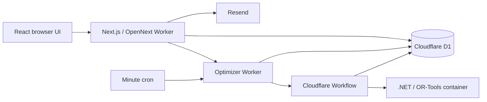

# Architecture

## Runtime boundaries

The application serves one club per installation/database. It has no multi-tenant data isolation within a shared database.

The website owns authentication, registration, validation, and publishing. The solver proposes a plan; TypeScript independently validates it before saving. Email delivery is an external side effect, separate from database commits.

## Website and API

`app/page.tsx` renders `app/open-bane-app.tsx`. The page is dynamic so framework scripts receive a fresh CSP nonce. Personal state comes from the API and must not be shared through public caching.

| Route | Responsibility |
| --- | --- |
| `/api/app` | Login, profiles, registrations, calendar, and administration; role-filtered state |
| `/api/optimizer` | Synchronous compatibility flow and plan editing/validation |
| `/api/optimizer/jobs` | Durable calculation requests and status |
| `/api/past-plan` | Historical plan access |
| `/api/plan-email` | Plan email workflow |
| `/api/privacy` | Member privacy actions |
| `/api/admin/privacy` | Privacy review and newsletter administration |
| `/api/newsletter` | Explicit personal-link actions |
| `/api/superadmin/prompt` | Protected match-plan prompt generation |
| `/api/health` | Release identifier and database compatibility |

Authorization is action-specific inside each handler; this table is not a permission grant.

## Login presentation and app identity

The unauthenticated view in `app/open-bane-app.tsx` uses the approved Åben Bane artwork and styles scoped under `.login-page` in `app/globals.css`. Members and administrators share the same membership-number/PIN form; administrator MFA continues in `app/mfa-screen.tsx`. “Opret profil” opens the existing registration flow, not a separate account system.

`app/layout.tsx` supplies browser and Apple touch icons, and `app/manifest.ts` supplies the installation name, colors, and icons. Approved assets live in `public/brand/`. The member header also uses the approved app icon. See [login design and branding](login-design.md) for provenance and maintenance constraints.

## Storage and jobs

Drizzle and custom SQL share D1; [DATAMODEL.md](../DATAMODEL.md) covers both. `matches` stores stable player IDs. `events.imported_kampplan` stores spreadsheet-compatible rows and optional optimizer metadata. Imported names must resolve unambiguously when converted to IDs.

Some app reads have side effects: `ensureEvent()` can refresh registration deadlines for a future automatic draft. Browsing an application is not equivalent to a read-only database export.

The durable optimizer stores an immutable input snapshot, dispatches through cron and Workflows, and saves a draft independently of the browser. The existing plan remains until a replacement saves successfully. Publishing is a separate action. See [background jobs](optimizer-background-jobs.md).

## Source map

| Location | Responsibility |
| --- | --- |
| `app/`, `components/` | Pages, interactive views, and shared UI |
| `lib/optimizer.ts`, `lib/plan-review.ts` | Validation and scoring |
| `lib/optimizer-server.ts`, `lib/optimizer-job-core.ts` | Input construction and durable jobs |
| `optimizer-service/` | C# solver, HTTP service, and self-tests |
| `optimizer-cloudflare/` | Container, Workflow, and cron |
| `lib/auth.ts`, `lib/admin-mfa.ts` | Authentication and sessions |
| `lib/privacy-service.ts`, `app/api/admin/privacy/route.ts` | Privacy and newsletter administration |
| `drizzle/` | SQL, metadata, and checksums |
| `scripts/` | Development and operations tooling |
| `tests/` | Unit and isolated integration tests |

## Environments

Sandbox uses `.wrangler/local-dev/v3`; Production uses remote D1 from `wrangler.jsonc`. Local `.dev.vars` is not uploaded by releases. The production optimizer Worker shares Production D1 with the website.

A full database copy also carries authentication state and queued jobs, but not the encryption keys or service configuration required to use them. Read [Sandbox refresh](sandbox-refresh.md) before copying or enabling workers against a copied database.
